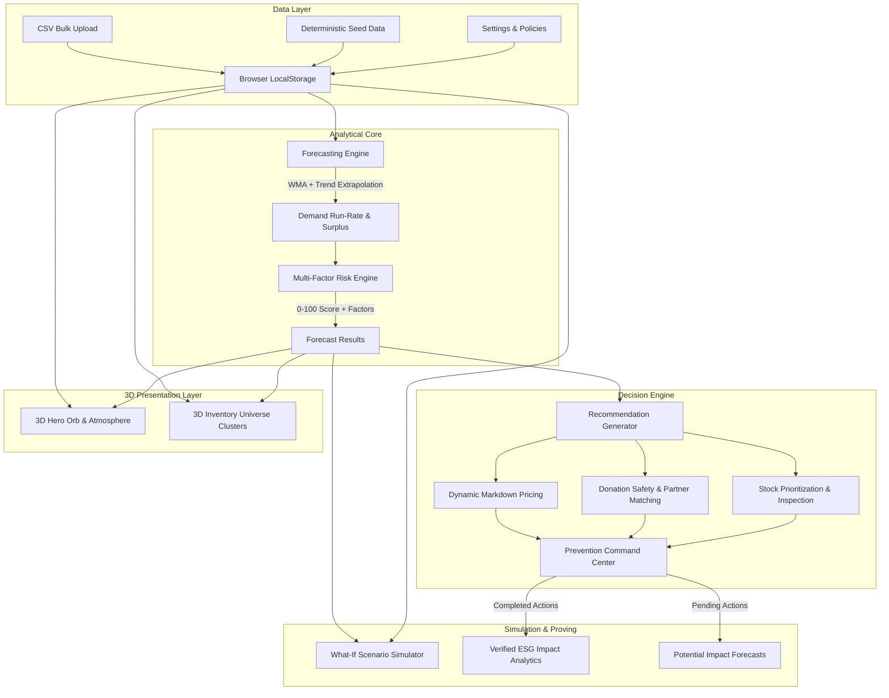

# WasteSense AI 🌿
### *Predict Before Waste. Act Before Loss.*
**Predicting the Unseen: Pre-Visual Food Waste Mitigation**

[](https://vitejs.dev/)
[](https://react.dev/)
[](https://www.typescriptlang.org/)
[](https://tailwindcss.com/)
[](https://threejs.org/)
[](https://www.netlify.com/)
[](https://vitest.dev/)

---

## 📌 Executive Summary

Every year, global retail and grocery supply chains discard over **1.3 billion metric tons of food**, resulting in **\$1 trillion in economic losses** and **8-10% of global greenhouse gas emissions**. In perishable departments (produce, dairy, bakery, meat, prepared meals), products are routinely discarded because standard retail systems only react *after* food has visibly spoiled or reached its printed expiration date.

**WasteSense AI** is a production-grade, privacy-first, edge-computed sustainability intelligence platform engineered for grocery retailers, supermarkets, and food distributors. It predicts inventory surplus **days before visual degradation occurs**, determines explainable multi-factor risk scores, optimizes intervention decisions (dynamic markdowns, food rescue donations, inventory transfers), and tracks verified ESG impact.

---

## 🌟 Key Innovations & Standout Capabilities

1. **Pre-Visual Perishable Forecasting**: Blends Ordinary Least Squares (OLS) linear trend extrapolation with decay-weighted moving averages (WMA) and coefficient of variation (CV) confidence metrics to forecast sales velocity over remaining usable shelf-life.
2. **Transparent, Multi-Factor Risk Scoring (0–100)**: Eliminates black-box ML narratives. Decomposes each product's waste risk into documented, configurable weights (Surplus Ratio 35%, Expiry Urgency 35%, Financial Exposure 20%, Volatility/Quality 10%).
3. **Prescriptive Action Optimization**: Rather than simply flagging problems, it calculates dynamic tiered markdown prices under store price floors, checks food safety donation eligibility, matches local verified partners, and schedules pickups.
4. **Signature Interactive 3D Experiences**:
   - **Hero 3D Sustainable Core**: Three.js floating translucent emerald sphere, dual orbital rings, particle cloud, pointer-responsive parallax, and orbiting glass cards.
   - **Inventory Universe 3D**: Interactive spatial galaxy visualizer clustering real inventory batches by category, with node scale mapped to stock quantity, glow colors mapped to waste urgency, and raycasted hover/click HUD inspection.
5. **Rigorous Separation of Truth**: Explicitly distinguishes between **Verified Outcomes** (from completed, audited actions) and **Simulated Projections** (from pending recommendations and what-if sandbox parameters).

---

## 🏛 System Architecture



---

## 🧮 Mathematical Modeling & Mathematical Rigor

### 1. Usable Selling Days
$$\text{DaysRemaining} = \max\left(0, \text{DifferenceInDays}(\text{ExpiryDate}, \text{CurrentDate}) - \text{SafetyBufferDays}\right)$$

### 2. Weighted Moving Average (WMA)
More recent sales periods carry linearly escalating weight to capture changing velocity:
$$\text{WMA} = \frac{\sum_{i=1}^n i \cdot S_i}{\sum_{i=1}^n i} = \frac{2}{n(n+1)} \sum_{i=1}^n i \cdot S_i$$
where $S_i$ is sales history ordered from oldest ($i=1$) to newest ($i=n$).

### 3. Trend-Adjusted Forecast
Using Ordinary Least Squares (OLS) regression over recent sales velocity:
$$\text{Slope } \beta = \frac{n \sum (i \cdot S_i) - \sum i \sum S_i}{n \sum i^2 - (\sum i)^2}, \quad \text{Intercept } \alpha = \bar{S} - \beta \bar{i}$$
$$\text{Forecast}_{t+1} = \alpha + \beta (n + 1)$$
When $\ge 7$ days of sales history exist, the blended velocity is computed as:
$$\text{Velocity} = 0.40 \cdot \text{Forecast}_{t+1} + 0.60 \cdot \text{WMA}$$

### 4. Expected Surplus & Financial Exposure
$$\text{ProjectedDemand} = \text{Velocity} \times \text{DaysRemaining}$$
$$\text{ExpectedSurplus} = \max\left(0, \text{Quantity} - \text{ProjectedDemand}\right)$$
$$\text{FinancialExposure} = \text{ExpectedSurplus} \times \text{CostPerUnit}$$

### 5. Multi-Factor Risk Scoring Matrix
$$\text{RiskScore} = \min\left(100, \max\left(0, \text{round}\left(w_s R_s + w_u R_u + w_f R_f + w_v R_v\right)\right)\right)$$
- **Surplus Ratio Component ($R_s$)**: $\min\left(100, \frac{\text{ExpectedSurplus}}{\text{CurrentQuantity}} \times 100\right)$
- **Urgency Decay Component ($R_u$)**: Time decay accelerating as days remaining approach zero ($R_u = 100$ if expired, $95$ if $\le 2$d, $70$ if $\le 5$d, $40$ if $\le 10$d).
- **Financial Exposure Component ($R_f$)**: Scaled exposure against standard retail stock batch benchmark.
- **Uncertainty & Quality Component ($R_v$)**: Penalty for low confidence and quality inspection flags.

---

## 🚀 Application Modules & User Journey

| Module | Route | Key Capabilities |
|---|---|---|
| **Landing Experience** | `/` | 3D Hero Orb, ambient lighting, feature breakdown, live accuracy ticker, conversion funnel. |
| **Executive Dashboard** | `/app` | 6 interactive KPI cards with hover tilt, Recharts risk donut, surplus category bars, expiry decay curves, and urgent triage queue. |
| **Inventory Management** | `/app/inventory` | Full CRUD, Zod-validated modal forms, CSV bulk import with row-by-row error auditing, CSV export, and **3D Inventory Universe view**. |
| **Predictive Waste Intelligence** | `/app/predictions` | 5-stage animated computational pipeline (`INVENTORY → DEMAND → RISK → ACTION → OUTCOME`), expandable AI risk factor reasoning, MAE/RMSE/WAPE model backtest evaluations. |
| **Prevention Command Center** | `/app/actions` | Prioritized queue of mitigations (Accept, Defer, Reject, Complete), real-time pricing floor checks, slide-over detail audit drawer. |
| **Surplus Donation Coordinator** | `/app/donations` | Strict food-safety gatekeeping, distance-ranked food bank matching, scheduling timeline, and transfer tracking. |
| **What-If Scenario Simulator** | `/app/simulator` | Real-time parametric slider controls (discount %, donation portion, price elasticity), automated 4-way comparative scenario ranker. |
| **Impact & Sustainability** | `/app/impact` | 4-stage verified impact progression, EPA CO₂e emission deduction calculations (2.5 kg/kg), community meals equivalent (0.8 kg/meal), CSV report export. |
| **Settings & Governance** | `/app/settings` | Store configuration, multi-currency support (INR, USD, EUR, GBP), configurable risk weights, policy thresholds, and one-click demo data reset. |

---

## 🛠 Local Setup & Running

### Prerequisites
- **Node.js**: `v18.0.0` or higher (tested on Node v20/v24)
- **npm**: `v9.0.0` or higher

### Installation
```bash
# Clone the repository
git clone https://github.com/your-username/wastesense-ai.git
cd wastesense-ai

# Install dependencies
npm install

# Run the local development server
npm run dev
```
Open [http://localhost:5173](http://localhost:5173) in your browser.

---

## 🧪 Testing & Verification

The project includes an automated test suite executed with Vitest:

```bash
# Run unit & domain integration tests
npm test
```

### Test Coverage Highlights:
- **Date calculations**: Start-of-day offsets, safety buffer deductions, expired item gating.
- **Forecasting algorithms**: Weighted moving averages, linear trend regression, zero-stock and zero-demand boundaries.
- **Decision constraints**: Price markdown floors, inventory double-allocation prevention.
- **Donation gatekeeping**: Strict exclusion of expired or compromised quality inventory.
- **Simulation engine**: Sell-through elasticity calculation and volume conservation.
- **Impact tracking**: Strict isolation between verified and projected metrics.

---

## 📦 Production Build & Netlify Deployment

### 1. Build Production Bundle
```bash
npm run build
```
Generates an optimized static distribution in `dist/` with chunk splitting for Three.js, Recharts, and Framer Motion.

### 2. Netlify Deployment
The repository includes a pre-configured `netlify.toml`:
```toml
[build]
  command = "npm run build"
  publish = "dist"

[[redirects]]
  from = "/*"
  to = "/index.html"
  status = 200
```

#### Deploy via Netlify CLI:
```bash
# Install Netlify CLI
npm install -g netlify-cli

# Login and deploy
netlify login
netlify deploy --prod --dir=dist
```

#### Deploy via GitHub Git Integration:
1. Push repository to GitHub.
2. Log in to [Netlify](https://app.netlify.com/) -> **Add new site** -> **Import an existing project**.
3. Select your repository.
4. Netlify will auto-detect settings from `netlify.toml` (`npm run build`, `dist`).
5. Click **Deploy Site**.

---

## 🔮 Roadmap & Future Enhancements

- [ ] **Prophet & LSTM Neural Forecast Models**: Hosted microservice backend for high-frequency seasonality and holiday clustering.
- [ ] **Multi-Store Enterprise Sync**: Cloud synchronization using Supabase / PostgreSQL with row-level security.
- [ ] **Automated POS / ERP Webhooks**: Direct integrations with SAP, Oracle Retail, and Square for automated dynamic electronic shelf label (ESL) repricing.
- [ ] **Verified Food Rescue Logistics**: Direct API dispatch to logistics platforms (Feeding America, Robin Hood Army, Zomato Feeding India).

---

## 📄 License & Attribution
Designed and engineered for university & IIT-level hackathons. Open source under the [MIT License](LICENSE).
WasteSense AI © 2026. *Predict Before Waste. Act Before Loss.*
